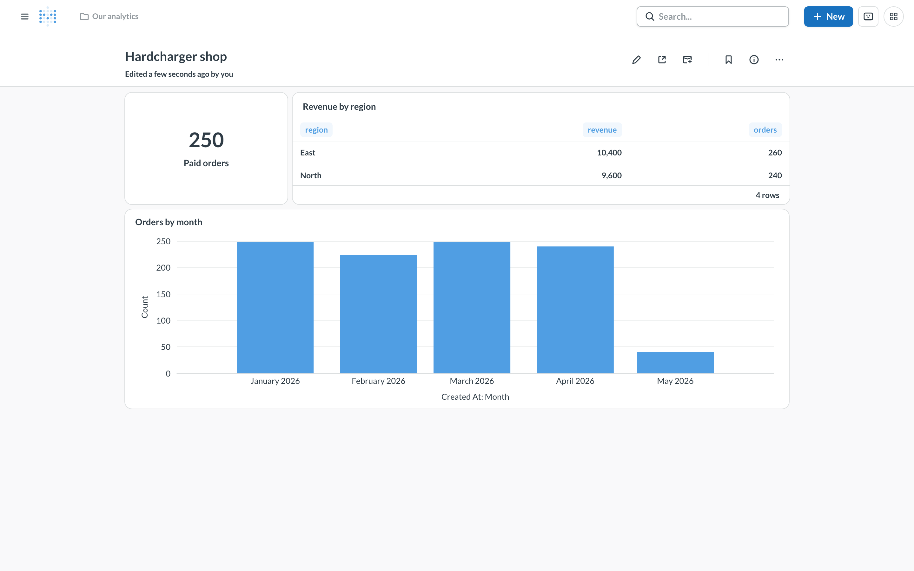
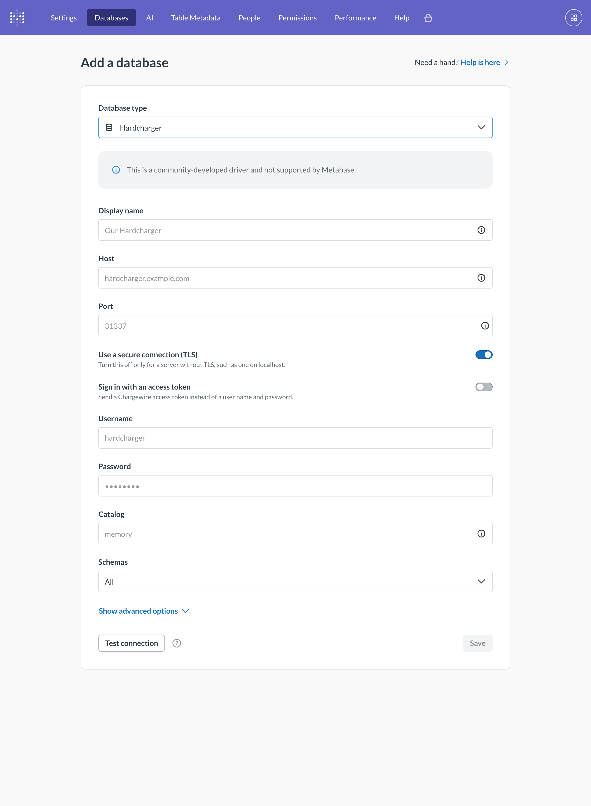
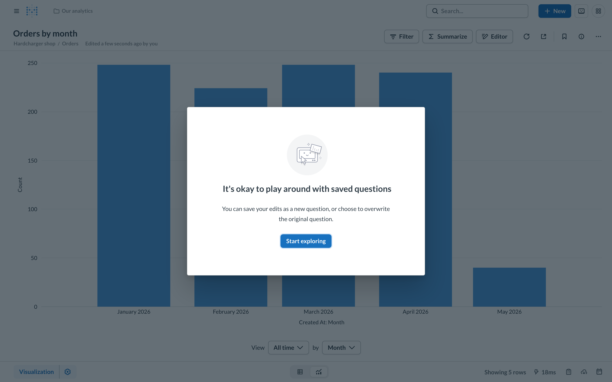
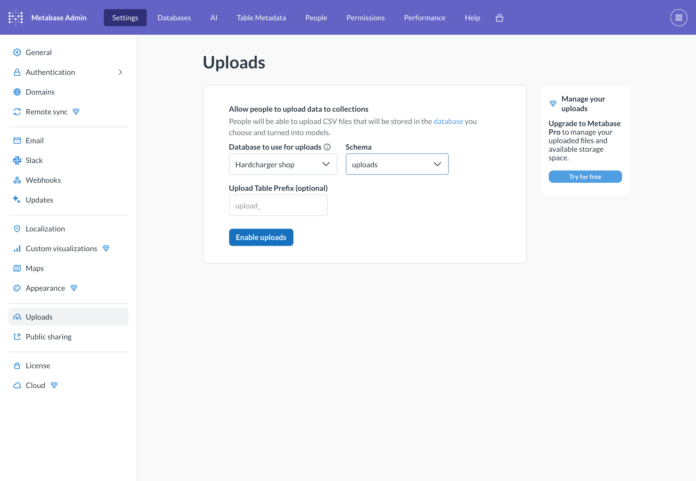

<p align="center">
  <a href="https://github.com/gizmodata/hardcharger">
    <picture>
      <source media="(prefers-color-scheme: dark)" srcset="https://raw.githubusercontent.com/gizmodata/metabase-hardcharger-driver/main/docs/assets/hardcharger-banner-dark.png">
      
    </picture>
  </a>
</p>

<h1 align="center">Hardcharger™ Driver for Metabase</h1>

<p align="center">
  <a href="https://github.com/gizmodata/metabase-hardcharger-driver/actions/workflows/ci.yml"></a>
  <a href="https://github.com/gizmodata/metabase-hardcharger-driver/releases/latest"></a>
  <a href="https://www.metabase.com"></a>
  <a href="https://github.com/gizmodata/hardcharger-jdbc"></a>
  <a href="https://github.com/gizmodata/chargewire"></a>
  <a href="https://github.com/gizmodata/hardcharger"></a>
  <a href="https://github.com/gizmodata/metabase-hardcharger-driver/blob/main/LICENSE"></a>
  <a href="https://gizmodata.com"></a>
</p>

<h3 align="center">Questions, dashboards and SQL in Metabase, on Hardcharger: remote DuckDB 2.0, over Chargewire.</h3>

---

A [Metabase](https://www.metabase.com) driver for [Hardcharger™](https://gizmodata.com/hardcharger),
GizmoData's DuckDB 2.0 server. It is one plugin jar, `hardcharger.metabase-driver.jar`, with the
[Hardcharger JDBC driver](https://github.com/gizmodata/hardcharger-jdbc) inside: it talks to the server
over **Chargewire HTTP(S)**, generates DuckDB SQL for Metabase's query builder, and reads tables,
columns, types and keys from DuckDB's own catalog.

<p align="center">
  
</p>

## Install

Community drivers are for self-hosted Metabase (Metabase Cloud does not load them).

1. Download `hardcharger.metabase-driver.jar` from the
   [latest release](https://github.com/gizmodata/metabase-hardcharger-driver/releases/latest).
2. Put it in Metabase's `plugins` directory (beside `metabase.jar`, or wherever `MB_PLUGINS_DIR` points).
3. Restart Metabase. **Hardcharger** is then in the list under **Admin > Databases > Add database**.

With Docker, mount a directory that holds the jar as the plugins directory:

```bash
mkdir -p plugins
curl -fL -o plugins/hardcharger.metabase-driver.jar \
  https://github.com/gizmodata/metabase-hardcharger-driver/releases/latest/download/hardcharger.metabase-driver.jar
chmod 777 plugins   # Metabase unpacks its own bundled drivers into the same directory

docker run -d --name metabase -p 3000:3000 \
  -v "$PWD/plugins:/plugins" -e MB_PLUGINS_DIR=/plugins \
  metabase/metabase:v0.65.4.3
```

Each release also has `hardcharger.metabase-driver.jar.sha256` to check the download against.

No JVM options are needed. Metabase's Docker image runs Java 25, which prints a one-time warning that
`sun.misc.Unsafe` was called (by Apache Arrow, inside the JDBC driver); it is harmless, and
`-e JAVA_OPTS=--sun-misc-unsafe-memory-access=allow` silences it.

## Connect

<p align="center">
  
</p>

| Setting | Default | Meaning |
|---|---|---|
| **Host** | | The server's host name, without a scheme or a path |
| **Port** | 31337, or 443 on a GizmoData Cloud host (`*.gizmodata.com`) | Leave empty for the default |
| **Use a secure connection (TLS)** | on | Turn it off only for a server without TLS, such as one on localhost |
| **Sign in with an access token** | off | Off: **Username** and **Password**. On: a Chargewire **Access token**, sent as it is. The driver cannot renew a token, so use one that outlives the connection's use |
| **Catalog** | the catalog the server starts sessions in | The catalog (database) Metabase syncs and queries. One Metabase database is one catalog; add the server again for another. Native SQL reaches other catalogs by their full name |
| **Schemas** | all | Metabase's schema filter: all, only these, or all except these |

Under **Show advanced options**:

| Setting | Default | Meaning |
|---|---|---|
| **Server CA certificate (PEM)** | | Extra certificate authorities to trust, for a server whose certificate a private CA signed |
| **Skip certificate verification** | off | Accept any certificate and host name. Development only |
| **Client certificate (PEM)**, **Client key (PEM)** | | For a server that asks for a client certificate (mutual TLS). The key is unencrypted PKCS#8, PKCS#1 RSA or SEC1 EC |
| **Sign in with the client certificate** | off | The certificate is the credential (a server started with `--mtls-certificate-sign-in`); no user name, password or token is sent |
| **Additional JDBC options** | | `key=value` pairs separated by `&`, from this list only: `async`, `pollWait`, `retainResults`, `ipcCompression`, `resultBufferSize`, `resultPartitions`, `resultOrder`, `connectTimeout`, `networkTimeout`, `resumeTimeout`, `basePath`, `useSystemTrustStore` (see the [JDBC driver's property table](https://github.com/gizmodata/chargewire-jdbc#properties)) |

Passwords, tokens, certificates and keys are stored as Metabase secrets. They reach the JDBC driver as
connection properties, never as part of a URL, and no error message repeats them. The additional options
are an allowlist because the JDBC driver has properties that name a program to run or a file to read;
those can only be set through the fields above. Browser sign-in is not offered: Metabase connects from
its server, where nobody could complete it.

**Writes.** Metabase marks the connections its questions use read-only, which the JDBC driver takes as a
hint: Hardcharger decides who may write by user and role, or for the whole server with `--read-only`. To
be sure a native SQL question cannot change data, connect Metabase as a user that may only read. For
[uploads and transforms](#uploads-and-transforms) that user needs the privileges listed there.

**GizmoData Cloud clusters that stop when idle.** Metabase's connection pool never starts a stopped
cluster, but its scheduled sync and scans do, like any query (by default every hour). To let a cluster
sleep, turn on **Choose when syncs and scans happen** in the database's advanced options and pick a less
frequent schedule.

## What works

<p align="center">
  
</p>

| Area | Supported |
|---|---|
| Sync | Tables and views with their comments; columns with their full DuckDB type, comment, default and nullability; primary keys and foreign keys; fingerprinting and field-value scans |
| Query builder | Filters, sorting, limits; count, sum, average, min, max, distinct, cumulative sum and count, standard deviation, variance, median, percentile; `CASE`, `COALESCE`, custom columns and expression aggregations; joins (inner, left, right, full) and implicit joins through foreign keys; nested questions and models; binning |
| Dates and times | Every bucket (minute, hour, day, week, month, quarter, year) and extraction (minute of hour, hour of day, day of week, day of month, day of year, week of year, month, quarter, year); weeks start on the day Metabase's **First day of the week** says; relative dates; date arithmetic; differences between dates; time zone conversion; `now` |
| Text | `contains`, `starts with`, `ends with` with or without case; concatenation, substring, trim, upper, lower, replace, length; regular expressions (RE2: no lookaheads or lookbehinds); `splitPart` |
| Window functions | Cumulative aggregations and offsets (`LAG`/`LEAD`) |
| Pivot tables | One statement with `GROUPING SETS` |
| Native SQL | Variables (text, number, date), field filters, snippets, questions and tables as `{{references}}` |
| CSV uploads | A file becomes a table in the schema an admin chose: create, append, replace; see [Uploads and transforms](#uploads-and-transforms) |
| Transforms | Table transforms from a query-builder question or from SQL: created, run, run again, on a schedule, with their dependencies read from the SQL |
| Report time zone | Metabase's report time zone is the session's `TimeZone`: buckets, filters on a day, and values with a time zone follow it. Without one, the session runs in the server's zone |
| Cancel and time limit | Cancelling a question cancels its statement on the server; Metabase's query timeout travels with each statement |

### Not supported

Metabase hides these for a Hardcharger database instead of offering them and failing:

| Feature | Why |
|---|---|
| Actions, editing table data, model persistence, Python transforms, transform tests | The other writing features. Each needs its own DDL and error handling proven against Metabase's tests before it is offered; none is implemented |
| A row-id column on uploaded tables | DuckDB has no auto-incrementing column type, so an uploaded table has the file's columns and no `_mb_row_id` |
| Connection impersonation, database routing | Metabase Enterprise features that switch role or connection per user; not implemented |
| Unfolding JSON columns into fields | JSON columns sync as one column and show as text. Use `->>` in a custom SQL question, or a view |
| Lookaheads and lookbehinds in regular expressions | DuckDB's regular expressions are RE2 |
| Index information | DuckDB's ART indexes do not make a column worth flagging |

## Uploads and transforms

Both write to the server as the user the connection signs in as, so that user needs the privileges, and
nothing happens until an admin turns each on in Metabase.

<p align="center">
  
</p>

**Uploads.** Under **Admin > Settings > Uploads**, choose the Hardcharger database and a schema (and,
if you like, a prefix for the tables), then **Enable uploads**. From then on a CSV dropped into a collection becomes a table in
that schema and a model on top of it; **Disable uploads** on the same page turns them off again. The
same over the API:

```bash
curl -sS -X POST "$METABASE_URL/api/upload/csv" \
  -H "X-Metabase-Session: $METABASE_SESSION" \
  -F collection_id=root -F "file=@orders.csv"
```

It answers with the new model's id (and the table's in the `metabase-table-id` header).
`POST /api/table/<table id>/append-csv` and `/replace-csv` take a file the same way.

| A CSV column of | becomes |
|---|---|
| whole numbers | `BIGINT` |
| numbers with a fraction | `DOUBLE` |
| `true` / `false` | `BOOLEAN` |
| dates | `DATE` |
| dates with a time | `TIMESTAMP`, exactly as written |
| dates with a time and an offset (`2026-03-08T01:30:00-05:00`, `...Z`) | `TIMESTAMP WITH TIME ZONE`: the instant, whatever the offset it was written with |
| anything else | `VARCHAR` |

None of that depends on a time zone: the zone of Metabase's JVM, the report time zone and the server's
zone do not change what is stored. Appending a file whose values no longer fit widens the column (whole
numbers to `DOUBLE`, booleans to `BIGINT`) and adds columns the table didn't have. Metabase's open-source
edition has no screen to delete an uploaded table: drop it in Hardcharger (`DROP TABLE uploads."..."`).

**Transforms.** Turn transforms on in Metabase (the `transforms-enabled` setting; a self-hosted Metabase
has it off until an admin enables it). A transform writes a query's result to a table of its own, in an
existing schema or one it creates; running it again replaces that table in one transaction, so readers
see the old table or the new one, never neither. Deleting a transform's table from Metabase drops it.

**Privileges.** On a server without access control the connection's user can do all of this. With it,
grant what is used and no more. These statements are from this repository's end-to-end check, where a
user with exactly them uploads, appends and runs transforms into the `uploads` schema:

```sql
CREATE ROLE loader;
GRANT SELECT ON SCHEMA shop TO loader;              -- what the questions and transforms read
GRANT ALL PRIVILEGES ON SCHEMA uploads TO loader;   -- where uploads and transforms write
CREATE USER uploader WITH PASSWORD '...';
GRANT loader TO uploader;
```

A transform into a schema that does not exist yet also needs `CREATE SCHEMA` on the catalog. Without a
privilege, the upload or the transform run fails with the server's own reason, for example:

```text
Permission Error: Hardcharger blocked this statement: user viewer has no CREATE TABLE privilege on schema memory.uploads.
```

## Types

How each DuckDB type appears in Metabase.

| DuckDB type | Metabase type | Notes |
|---|---|---|
| `BOOLEAN` | Boolean | |
| `TINYINT`, `SMALLINT`, `INTEGER`, `UTINYINT`, `USMALLINT` | Integer | |
| `BIGINT`, `UINTEGER`, `UBIGINT`, `HUGEINT`, `UHUGEINT` | BigInteger | A `HUGEINT` or `UHUGEINT` value above 38 digits cannot be sent: the server says so, and to cast it to `VARCHAR` |
| `DECIMAL(p, s)` | Decimal | `DECIMAL(p, 0)` is a BigInteger. `SUM` over an integer column is a `HUGEINT` in DuckDB and arrives as a whole number |
| `FLOAT`, `DOUBLE` | Float | |
| `VARCHAR`, `CHAR` | Text | |
| `ENUM` | Text | |
| `UUID` | UUID | Filters and joins work; values arrive as text |
| `DATE` | Date | |
| `TIME`, `TIME_NS` | Time | |
| `TIME WITH TIME ZONE` | Time | The offset is not sent: the time reads as written |
| `TIMESTAMP`, `TIMESTAMP_S`, `TIMESTAMP_MS`, `TIMESTAMP_NS` | DateTime | Fractions of a second are kept to the column's precision |
| `TIMESTAMP WITH TIME ZONE` | DateTime with local time zone | An instant, shown in the report time zone |
| `JSON` | JSON | Shown as text |
| `LIST`, `ARRAY` (`T[]`, `T[n]`) | Array | Shown as text: `[1, 2, 3]` |
| `STRUCT`, `MAP` | Dictionary | Shown as text: `{"a": 1, "b": "x"}` |
| `UNION` | unknown (`type/*`) | Shown as the member it holds |
| `INTERVAL` | unknown | Shown as ISO 8601 text: `P1Y2M3DT4H` |
| `BLOB` | unknown | |
| `BIT`, `BIGNUM`, `VARIANT`, `GEOMETRY` | unknown | They arrive in their binary form; cast them in a view or a SQL question (`::VARCHAR`, `::JSON`) to read them |

For a column of unknown type the query builder offers little beyond showing and counting it.

## Tested versions

| | Version |
|---|---|
| Metabase | **0.65.4.3** (Metabase's driver test suite and the end-to-end check) and **0.65.1** (the end-to-end check) |
| Hardcharger | **2.12.0** (DuckDB 2.0.0, Chargewire 2.4.1) |
| Hardcharger JDBC driver (bundled) | 2.4.4, on the Chargewire JDBC driver 2.2.6 |

The driver needs Metabase 0.65: it uses driver interfaces that 0.65 added, so it does not load in 0.64 or
earlier. Each release is built against the Metabase version in [`metabase.version`](metabase.version), and
CI also runs the end-to-end check with that jar on 0.65.1, the first stable 0.65. Later Metabase releases
are expected to work and are not tested until `metabase.version` moves to them.

Every push runs, against a real Hardcharger server:

- **Metabase's own driver test suite**: every test tagged for drivers in Metabase's open-source test tree,
  with the driver's test extensions loading Metabase's datasets into Hardcharger (each dataset an in-memory
  catalog), plus this driver's tests.
- **An end-to-end check**: the Metabase Docker image with the built jar; the database is added through the
  API, synced, queried from the query builder and in SQL, under a non-UTC report time zone, cancelled
  mid-query, put on a dashboard that is rendered in a browser, and connected over TLS with a private CA and
  with a client certificate. A CSV with every upload type is uploaded, appended to, replaced and widened;
  transforms are created, run, run again and dropped; both are tried as a user without the privileges and
  as one with just enough; and the upload's dates and times are checked with the Metabase JVM, the report
  time zone and the Hardcharger server in three different zones each.

Releases are published only after both have passed on the tagged commit.

What the suite does not run for this driver, and why:

| Tests | Why |
|---|---|
| UUID value tests (`:uuid-type`) | UUID values arrive as text (see Types) |
| Materialized view sync | DuckDB has no materialized views |
| Binary columns read as timestamps (two datasets) | Metabase's datasets name the binary column's type per built-in driver; a community driver cannot add its own. The conversion is tested in this repository instead |
| Actions, persistence, Python transforms, impersonation, routing, JSON unfolding | Not supported (above) |
| Two transform tests about database routing | They need code from Metabase's `enterprise/` directory on the class path |
| Metabase's `enterprise/` tests | They are under Metabase's commercial licence and test features this driver does not declare |

## Develop

```bash
make jar      # dist/hardcharger.metabase-driver.jar, built by Metabase's own driver build
make lint     # clj-kondo with Metabase's configuration
make test     # Metabase's driver test suite and this driver's tests, against a server it starts
make e2e      # the end-to-end check (Docker)
```

It needs JDK 21, the [Clojure CLI](https://clojure.org/guides/install_clojure),
[uv](https://docs.astral.sh/uv/) (for the test server's Python package, and because Metabase's tests
install their SQL parser with it), Docker and openssl. A Metabase driver is built inside a Metabase source
checkout: the first `make` clones Metabase at the version in `metabase.version` into
`~/.cache/metabase-hardcharger-driver/` and links this repository into it. The `hardcharger` Python package
downloads the server binary on first use; `HARDCHARGER_SERVER_BINARY` names another build.

## License

Apache License 2.0; see [LICENSE](LICENSE), [NOTICE](NOTICE) and
[THIRD-PARTY-NOTICES.md](THIRD-PARTY-NOTICES.md) for what the jar bundles. Written after GizmoData's
[Metabase GizmoSQL driver](https://github.com/gizmodata/metabase-gizmosql-driver) and MotherDuck's
[Metabase DuckDB driver](https://github.com/motherduckdb/metabase_duckdb_driver) (both Apache-2.0).

---

<p align="center"><sub>Hardcharger™ and GizmoData™ are trademarks of GizmoData LLC. Metabase is a trademark of Metabase, Inc.; this driver is not affiliated with or endorsed by Metabase, Inc.</sub></p>
